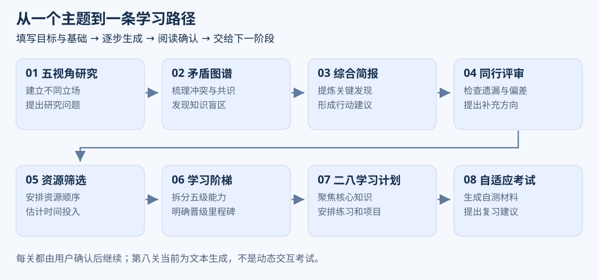
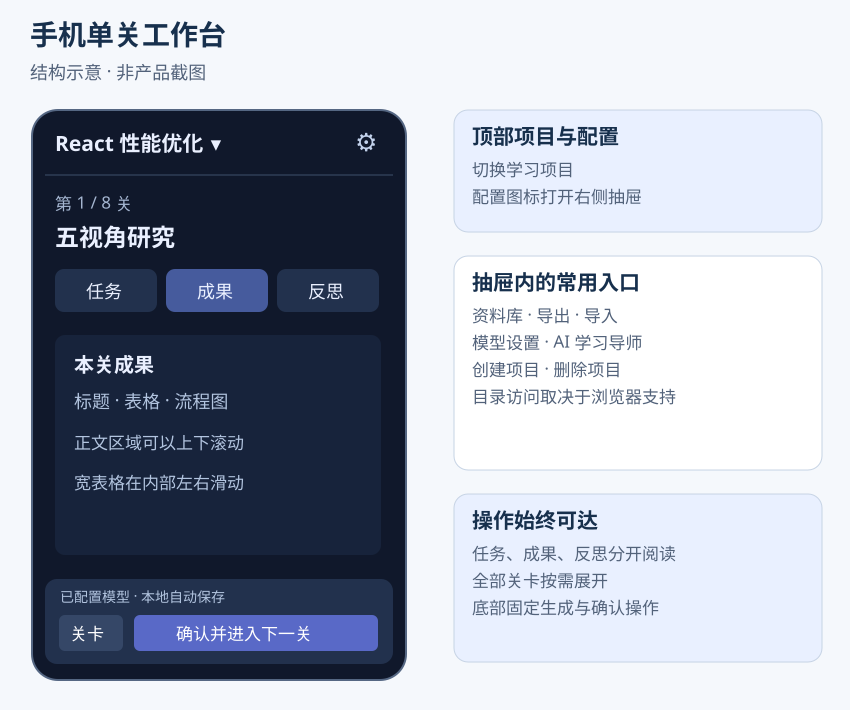
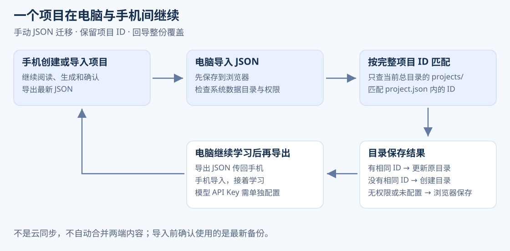

# Knowledge Quest 知识征途

将行业研究与技术学习整理成八阶段路径的 AI 学习工作流工具。填写主题、目标、基础和时间预算，逐步生成研究材料、资源建议、能力阶梯与学习计划，阅读确认后进入下一阶段。

当前发布版本为 **V3.3**，支持 PC 和手机浏览器。项目默认保存在当前浏览器，可选择电脑目录保存副本，也可以通过 JSON 在设备间迁移。



## 主要功能

- **多项目管理**：创建、切换和删除行业或技术学习项目，保留独立档案、进度和成果。
- **八阶段工作流**：五视角研究 → 矛盾图谱 → 综合简报 → 同行评审 → 资源筛选 → 学习阶梯 → 二八学习计划 → 自适应考试。
- **连续上下文**：生成时读取项目档案及上游已确认成果；确认解锁下一关，重新确认上游后提示下游检查更新。
- **成果阅读与版本**：流式预览、重新生成、版本保留及资料库；支持 Markdown 排版、表格和 Mermaid 图形。
- **手机工作台**：任务、成果、反思分标签查看，配置抽屉收纳常用操作，生成确认按钮常驻底部。
- **模型配置与导师**：配置兼容接口、模型 ID、温度与 API Key，加载模型列表、测试连接，并围绕项目进行导师问答。
- **保存与迁移**：浏览器自动保存、可选系统目录、JSON 双向迁移及按项目 ID 更新电脑原目录。

## 快速上手

1. 在“模型与设置”中配置兼容 Chat Completions 的接口地址、准确模型 ID 和 API Key，测试连接。手机已有项目时从顶部配置图标进入。
2. 点击“创建学习项目”，选择行业或技术知识，填写主题、目标、当前水平和小时预算。首次打开可能显示示例项目，可以先体验。
3. 在可用关卡生成成果，阅读正文和反思提示；需要另一版时重新生成，采用当前草稿时确认进入下一关。
4. 定期导出 JSON，在浏览器下载列表或手机“文件”中确认保存。换设备时导入最新文件继续使用。

未配置模型或服务请求失败时，会提供带说明的本地模板草稿，用于体验流程，不等同于完整的 AI 研究结果。

## 手机使用

已有项目且页面宽度不超过 850px 时启用单关工作台。顶部切换项目，配置图标展开资料库、导入导出、模型设置等操作；全部关卡按需展开。没有项目时保留创建、导入和设置入口。



手机通常不支持可写目录，以浏览器保存和 JSON 备份为主。较宽表格和图形在自身区域横向滚动，图形生成完成后绘制，解析失败时可查看源码。

## 系统数据目录与项目目录

在支持 File System Access API 的电脑浏览器中，可在设置选择系统数据目录。推荐通过 HTTPS 使用 PC Chrome 或 Edge，权限失效时重新选择并授权。

```text
系统数据目录/
└─ projects/
   └─ 项目名称-项目标识/
      ├─ project.json          # 完整项目和关卡记录
      ├─ artifacts.json        # 成果版本
      ├─ events.jsonl          # 最近一次保存事件
      └─ backups/
         └─ latest.json        # 最新项目副本
```

**系统数据目录**是多个项目的总文件夹，**项目目录**是其中一个项目的独立文件夹。完成创建向导后，若系统目录可用，会创建项目子目录并写入；后续生成与确认继续保存。启动时尝试扫描系统目录，补充浏览器中尚未加载的项目。

“打开项目目录”用于恢复已有 `project.json` 的单个项目文件夹。没有系统目录也可以使用浏览器记录；删除应用内项目不会删除磁盘副本。

## PC 与手机双向迁移



| 路径 | 操作与结果 |
| --- | --- |
| 手机新建 → PC | 手机导出 JSON，PC 导入；有可写系统目录就创建项目目录，否则保存在浏览器并提示 |
| PC → 手机 → PC | PC 导出，手机导入继续学习，再导出回 PC；按完整项目 ID 匹配当前系统目录中的原项目并更新 |
| 同一项目再次导入 | 浏览器已有同 ID 时确认覆盖，整份替换，不自动合并两端修改 |

- 匹配当前系统目录 `projects/` 下 `project.json` 内的 ID，不依赖项目名称或备份文件名；不自动更新总目录外的旧绑定。
- 备份保留档案、关卡、成果版本和反思，不包含模型配置、API Key、目录授权和导师聊天。
- 文件名带导出时间，大小上限 20 MB。生成中的请求不能跨设备继续，备份里的状态转为可重试。
- 建议同一时间在一个设备继续学习，导入最新备份。当前没有自动云同步、新旧版本拦截或冲突合并。
- 目录写入失败时保留浏览器数据并提示。多文件写入不是原子事务，失败后检查权限并重新导入。

## 本地开发

建议使用 Node.js 24 LTS 和项目指定的 `pnpm@11.19.0`。

```bash
pnpm install --frozen-lockfile
pnpm dev
```

测试与构建：

```bash
pnpm test
pnpm build
```

生产产物为 `dist/`，可通过 `pnpm exec vite preview` 本地预览。技术栈包括 React、TypeScript、Vite、Zod、react-markdown、remark-gfm 和按需加载的 Mermaid；项目使用 localStorage，目录句柄使用 IndexedDB。

## 发布与部署

当前为纯前端静态站点，无需服务器项目数据库或 Node.js 常驻进程。部署时将构建目录内**全部内容**放到网站根目录，保留完整 `assets/`，避免漏传按需加载的图形文件。

V3.3 发布目录为 `dist_V3.3/`，压缩包为 `dist_V3.3.zip`。新版本打包时先构建对应版本目录，再压缩该目录。以下以尚未发布的 V3.4 为操作示例：

```bash
pnpm build -- --outDir dist_V3.4
```

```powershell
Compress-Archive -LiteralPath .\dist_V3.4 -DestinationPath .\dist_V3.4.zip
```

HTTPS、Nginx 和更新步骤见 [部署手册](docs/DEPLOYMENT.md)。

## 当前能力边界

- 八个 Skill 采用统一模型生成流程；“自适应考试”为文本材料生成，尚无逐题交互、动态难度或真实能力测量。
- 反思报告采用基础预设评分与阈值判断，不是独立 AI 内容审核，也没有自动修订闭环。
- 尚未接入独立联网搜索和引用核验，模型提供的事实、资源和链接需要自行确认。
- 导师使用主题、目标与当前关卡名称，不自动读取所有成果，对话不长期保存。
- 当前没有附件或 PDF 导入、PDF 或 Word 成果导出、账户系统或原生桌面客户端。

API Key 只保存在当前标签页的 sessionStorage，不写入项目文件。模型请求由浏览器直接发往配置的服务，需要满足网络与 CORS 条件；生成会发送项目档案及已确认上游内容。清理浏览器数据或切换站点来源前，请先备份。

## 产品文档

| 文档 | 用途 |
| --- | --- |
| [当前 PRD](docs/PRD.md) | 产品定位、功能范围、业务规则与验收条件 |
| [PRD 阅读版](docs/PRD_V3.3.html) | 浏览器图文阅读 |
| [产品介绍与使用指南](docs/USER_GUIDE.md) | 场景、步骤、迁移说明和运营文案 |
| [图文使用指南阅读版](docs/USER_GUIDE.html) | 浏览器阅读、演示与打印 |
| [文档入口](docs/DOCUMENTS.md) | 阅读方式及维护说明 |
| [早期规划](docs/PRD.original-plan.md) | 历史桌面版构想，不代表当前实现 |

HTML 可直接用浏览器打开，分享时保留相邻 `assets/` 图片目录。重新生成阅读版和示意图：

```bash
node docs/build-product-docs.mjs
```
