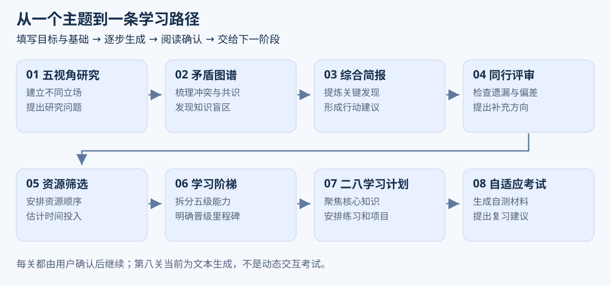
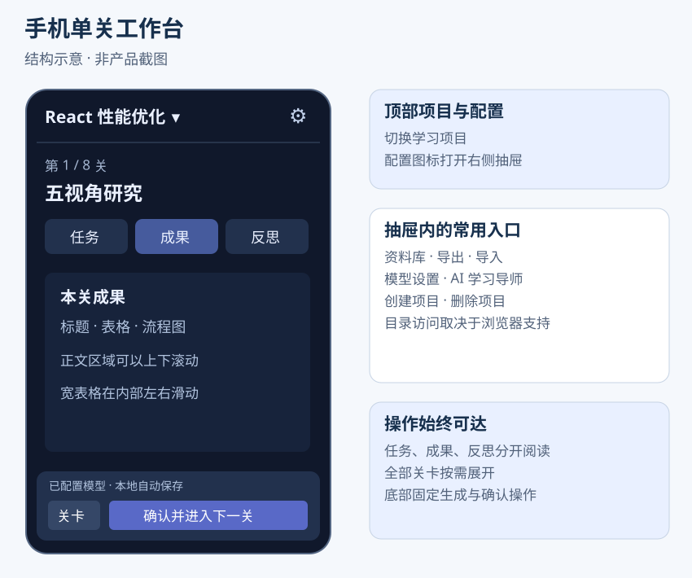
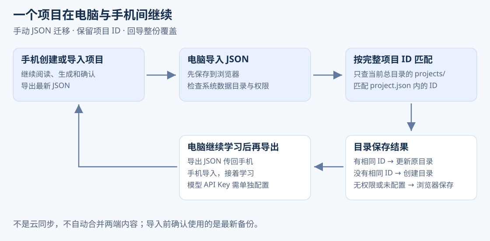

# Knowledge Quest 产品需求文档

版本基线：V3.3 · 更新日期：2026年11月3日 · 状态：基于当前源码整理

本文面向产品、研发、测试和运营，描述当前可用能力、业务规则、验收条件与后续方向。产品已实现浏览器端的八阶段 AI 学习工作流、多项目管理、电脑目录保存和手机电脑双向备份迁移。[早期规划](PRD.original-plan.md) 包含尚未完成的桌面版设想，不应作为当前已上线能力的依据。

## 1 产品定位与目标

Knowledge Quest 知识征途是一款面向行业研究和技术学习的 AI 学习工作流工具。用户填写主题、目标、基础和时间预算后，按八个阶段生成研究与学习材料，阅读成果并逐步确认。每步生成会读取项目档案及上游已确认成果，帮助用户把分散提问整理成连续路径。

当前为静态站点部署的 React 浏览器应用。PC 和手机使用相同项目数据格式，采用浏览器本地记录、可选电脑目录副本与 JSON 备份保存项目，不依赖服务端项目数据库。

产品目标：降低开始新主题时的组织成本；让研究、资源选择和学习计划具备连续上下文；使当前关卡、已有成果和下一步操作清晰；支持电脑和手机之间手动接续。

## 2 用户与问题

| 用户 | 典型问题 | 当前支持 |
| --- | --- | --- |
| 技术学习者 | 不清楚先学什么，资料和计划脱节 | 连续生成资源建议、能力阶梯与学习计划 |
| 新行业从业者 | 信息视角单一，难整理共识与争议 | 五视角、矛盾图谱、简报与同行评审材料 |
| 多设备用户 | 换设备后学习记录难以接续 | 保留项目 ID、成果与关卡状态的 JSON 迁移 |
| 多主题学习者 | 多段聊天难归档 | 独立项目、项目切换、成果资料库 |

## 3 当前范围与宣传边界

| 能力 | 已实现内容 | 不应宣称的能力 |
| --- | --- | --- |
| 项目创建 | 行业或技术类型，四个固定访谈问题 | 动态 AI 访谈与自动追问 |
| 八阶段生成 | 同一模型执行器配合不同 Skill 指令 | 所有事实都经过外部核实 |
| 反思报告 | 预设分数组合、阈值判断和问题提示 | 独立模型逐条审核、自动修订闭环 |
| 自适应考试 | 按考试 Skill 生成 Markdown 材料 | 逐题交互、动态难度和真实能力测量 |
| 资源建议 | 由模型生成资源相关内容 | 独立联网搜索、网页抓取和引用核验 |
| 学习导师 | 注入主题、目标、当前 Skill 名称的问答 | 自动检索全部项目成果、长期保存导师对话 |
| 图文阅读 | Markdown、GFM 表格与 Mermaid 图形 | 所有字符画均可自动变图 |
| 双向迁移 | 手动导出导入 JSON | 自动云同步、两端内容自动合并 |
| 文件能力 | JSON 备份与电脑目录副本 | PDF 或附件导入、PDF 或 Word 成果导出 |

## 4 核心用户流程

1. 创建项目，选择行业或技术知识，填写主题、目标、当前水平与小时预算。
2. 配置兼容模型接口地址、准确模型 ID 与 API Key，测试连接。
3. 运行当前可用关卡，观看流式输出；模型不可用时提供带说明的本地模板草稿。
4. 阅读成果和基础反思提示，必要时重新生成并保留新版本。
5. 确认草稿，解锁下一关；后续生成读取已确认的上游成果。
6. 查看资料库，或导出 JSON 转移设备后继续。

首次打开且尚无本地项目存储记录时，系统创建示例项目；已有空列表时显示无项目入口。示例不应算作用户主动创建项目。

## 5 功能需求

### 5.1 项目管理

用户可创建、切换和删除项目。各项目档案、关卡与成果相互独立。删除前确认，移除浏览器项目记录并保留磁盘副本；删除标记阻止启动扫描自动恢复。当前没有归档、回收站界面或永久删除磁盘文件入口。

### 5.2 八阶段 Skill

| 顺序 | 名称 | 提示词要求的主要产出 |
| --- | --- | --- |
| 1 | 五视角研究 | 角色立场、最强证据、独有问题、共识与冲突 |
| 2 | 矛盾图谱 | 冲突关系、共识、盲区、关键问题 |
| 3 | 综合简报 | 主题总览、关键发现、隐含关联、行动建议 |
| 4 | 同行评审 | 可靠性评分、遗漏信息、视角失衡、补充研究 |
| 5 | 资源筛选 | 资源评分、使用方式、投入时间、学习顺序 |
| 6 | 学习阶梯 | 五级目标、关键技能、晋级里程碑、练习与错误 |
| 7 | 二八学习计划 | 核心知识、课程计划、每日任务、最终项目 |
| 8 | 自适应考试 | 逐题反馈、强弱项、复习计划、返工建议等文本材料 |

以上为期望输出，实际质量取决于模型。第八关目前不提供真实交互考试服务。

### 5.3 工作流规则

初始只有第一关可开始，其他关卡锁定。生成中阻止并发执行；成功进入待确认，异常显示错误或模型失败的本地降级草稿。确认当前草稿后保存版本引用并解锁下一关。重新生成不删除旧成果。

重新确认某个上游后，已执行且非初始待开始状态的下游可能标记为 stale，提醒重新检查。内核有跳过函数，但页面没有跳过入口。完成百分比按已确认或已跳过的关卡计算，不代表真实知识掌握度。

### 5.4 PC 与手机界面

PC 展示项目侧栏、学习地图和成果工作区，足够宽时显示成果链路。手机在已有项目且宽度不超过 850px 时启用单关工作台：顶部项目选择与配置图标，任务成果反思标签，按需展开关卡列表，底部常驻生成确认按钮。无项目时保留创建、导入和设置入口。

配置抽屉包括创建项目、资料库、导出、导入、目录访问、模型设置、导师和删除项目。不支持目录时显示不可用。抽屉支持关闭按钮、背景关闭、Escape 和键盘焦点限制。

### 5.5 成果与版本阅读

支持 Markdown 标题、列表、引用、链接、代码块和 GFM 表格。宽表格只在自身区域横向滚动。Mermaid 在完成生成后绘图，流式阶段暂显示代码；错误图形保留源码。禁用原始 HTML、过滤危险链接协议并启用图形严格安全模式。

资料库汇总项目成果版本，点击后进入对应项目关卡。当前工作台显示该关最新成果，不提供独立的历史版本编辑界面。

### 5.6 模型设置与导师

采用兼容 Chat Completions 的接口与流式响应。设置包括接口、模型 ID、温度与 API Key；支持模型列表及真实短请求测试。非敏感设置进入 localStorage，API Key 进入当前标签页 sessionStorage，不进入备份。

导师注入项目主题、目标和当前阶段名称，不自动获得所有成果正文；关闭后的对话不作为项目记录持久化。

## 6 保存与双向迁移

### 6.1 保存层次

浏览器记录用于日常继续学习。系统数据目录是电脑总目录，项目目录位于其 `projects/` 下。项目内维护 `project.json`、`artifacts.json`、最近保存事件 `events.jsonl` 和最新备份 `backups/latest.json`。后两项不是无限追加日志或多个时间点的备份集。

目录访问依赖浏览器和安全上下文，推荐 HTTPS 下的电脑 Chrome 或 Edge。权限失效时可能需要重新选择目录。手机以浏览器保存和 JSON 备份为主。

### 6.2 导入导出规则

JSON 保留项目 ID、档案、关卡、成果版本、反思与 mastery 数值；不包含模型设置、API Key、目录句柄和导师聊天。导出文件名带时间，上限与导入一致为 20 MB。生成中的状态在备份中转为可重试的失败状态，不能迁移正在进行的网络请求。

导入校验结构，容忍 UTF-8 BOM 并规范关卡顺序。浏览器已有同 ID 时确认覆盖。先保存浏览器，再尝试系统目录；失败保留浏览器数据并给出结果提示。

PC 扫描当前系统目录 `projects/` 下的 `project.json`，按完整项目 ID 匹配。找到则更新原目录，没有则创建。名称相同不代表同项目，改名不改变身份。写入后建立目录绑定供后续操作保存，不自动更新当前总目录以外的旧绑定。

无目录、无支持或权限失效时提示原因。整份导入不合并双端修改，不判断备份新旧。磁盘多文件写入不是原子事务，异常时可能仅部分更新。

## 7 数据与架构

| 对象 | 主要字段 | 用途 |
| --- | --- | --- |
| ProjectProfile | id、title、topic、kind、goal、currentLevel、timeBudgetHours | 项目身份与目标 |
| SkillRun | skillId、status、revision、confirmedArtifactId | 状态与确认版本 |
| SkillArtifact | id、revision、content、status、upstreamArtifactIds、reflection | 内容、版本与上游关系 |
| ReflectionReport | scores、overallScore、passed、weaknesses | 基础评分及问题提示 |
| ProjectWorkspace | profile、runs、artifacts、mastery | 保存与迁移单位 |

React、TypeScript、Vite 与 Zod 组成应用基础；react-markdown、remark-gfm 和按需加载的 Mermaid 负责阅读。localStorage 保存项目，IndexedDB 保存目录句柄。浏览器直接访问用户配置的模型服务，服务须满足网络与 CORS 条件。当前没有账户、服务端项目数据库或原生桌面容器。

## 8 验收标准

| 编号 | 场景 | 通过条件 |
| --- | --- | --- |
| A01 | 新建切换 | 两个项目档案和成果独立 |
| A02 | 生成确认 | 状态可见，草稿可确认，按规则解锁下一关 |
| A03 | 重复操作 | 生成不并发，导入写盘期间阻止生成确认和删除 |
| A04 | 文档阅读 | 表格不撑宽手机页，错误图形不破坏其他正文 |
| A05 | 手机工作台 | 按钮常驻、标签可切换、空项目入口保留 |
| A06 | 手机新建到 PC | 浏览器可见，可写目录下创建项目文件 |
| A07 | PC 手机 PC | 完整 ID 保留，更新原目录，不重复建目录 |
| A08 | 降级保存 | 无目录、权限撤销和写入失败时浏览器数据仍在 |
| A09 | 备份安全 | 不含密钥或句柄，拒绝非法 JSON，兼容 BOM |
| A10 | 重复导入 | 浏览器已有同 ID 时确认覆盖，取消不覆盖 |

现有测试覆盖生成生命周期、手机工作台状态、渲染结构和安全、JSON 往返及目录匹配。目录测试为模拟句柄，不能替代实际手机与 PC 的权限、下载和显示验收。构建验证指令为 `npm test` 和 `npm run build`。

## 9 风险与下一阶段

优先验证真实设备往返，完善旧备份识别、冲突预览、重新授权及写盘完整性。随后再考虑独立质量评估、来源核验、交互式考试与掌握度反馈。云同步、附件、PDF 导出和桌面版是候选方向，不是当前承诺。

建议关注创建、首次生成、首次确认、八关确认和跨端恢复漏斗，但目前没有后台埋点统计。没有实测前不宣称学习效率提升比例、用户规模或完成率。
