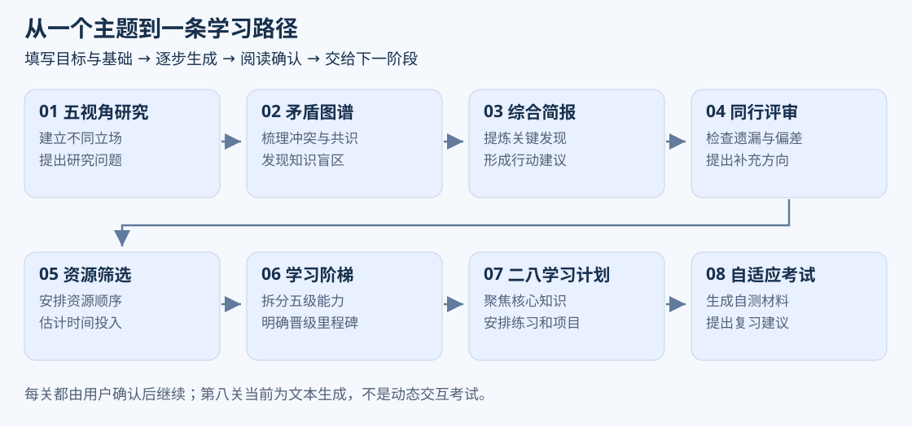
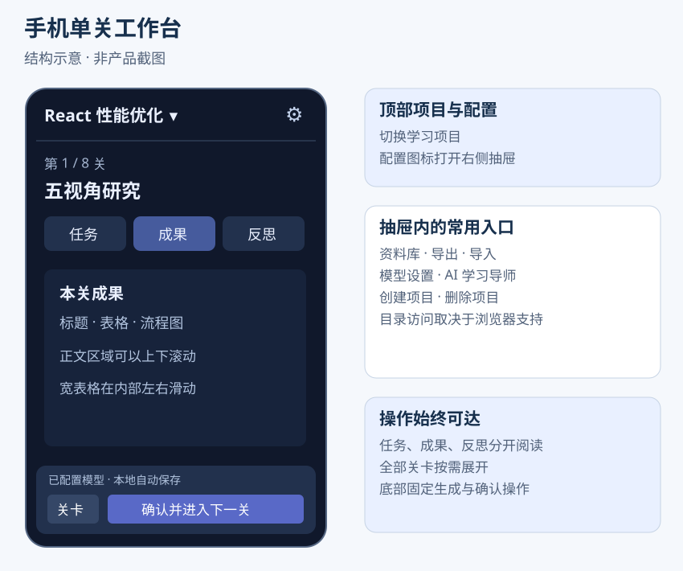
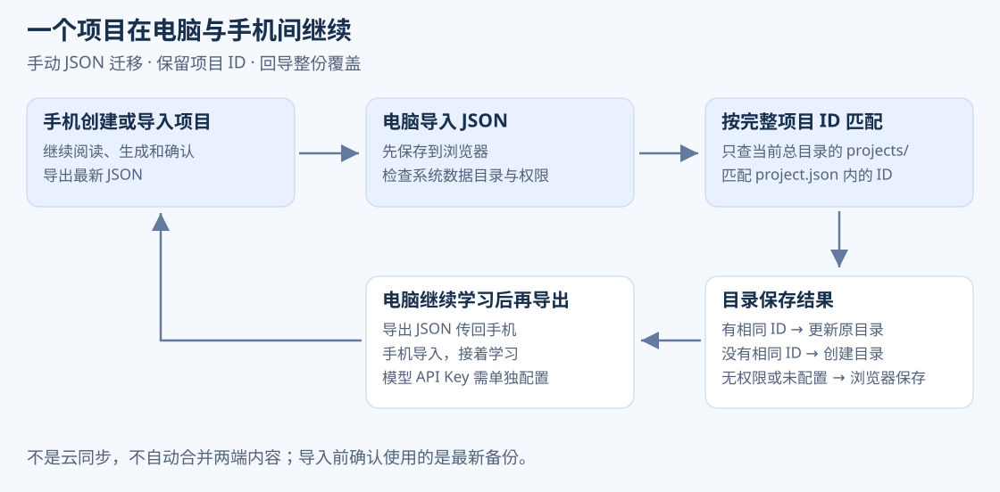

# Knowledge Quest 产品介绍与使用指南

适用版本 V3.3 · 2026年11月3日

Knowledge Quest 知识征途，把行业或技术学习整理成从研究、梳理到行动计划的八阶段路径。你可以在电脑集中研究，也可以把项目带到手机继续阅读与生成，再把新成果导回电脑。

本文用于产品介绍、上手指引和运营演示。配图为功能结构示意，不是产品截图；示例用于解释用法，不是已经核实的研究结果。

## 可以用它做什么

**了解新行业。** 想学习新能源汽车行业，可以从实践者、学者、怀疑者、经济学家和历史学家等视角开始，生成不同立场的研究材料，再梳理冲突、共识与简报，形成待查证的问题清单。

**安排技术学习。** 想提高 React 性能优化能力，可以填写基础、目标和时间预算，逐步获得资源建议、能力阶梯、课程与实践项目建议，再结合真实资料动手练习。

**管理多个学习主题。** 每个项目有自己的目标、进度与成果版本。重新生成时保留新版本，资料库集中展示各项目的已有产出。

**在电脑与手机间继续。** 导出项目 JSON 传到另一设备，再导入就能保留档案、成果和关卡进度，不必手动复制长段聊天。

## 解决什么问题

| 常见困扰 | 产品如何帮助 |
| --- | --- |
| 想学新主题却不知道从哪里开始 | 四个问题建立档案，按八阶段推进 |
| 每次向 AI 提问都要重新介绍背景 | 自动带入项目档案和上游已确认成果 |
| 研究、资料建议与学习计划各自分散 | 在同一项目中逐步生成并保留 |
| 长段文字、表格代码不好读 | Markdown 排版，表格与流程图渲染 |
| 手机上总要下拉寻找生成按钮 | 单关工作台，底部常驻生成和确认 |
| 换设备后难继续 | JSON 往返，电脑按项目 ID 更新原目录 |

## 八个阶段分别做什么

| 阶段 | 产出方向 |
| --- | --- |
| 五视角研究 | 不同立场、证据线索与独有问题 |
| 矛盾图谱 | 冲突、共识、知识盲区与关键问题 |
| 综合简报 | 主题概况、关键发现和行动建议 |
| 同行评审 | 遗漏、偏差和补充研究建议 |
| 资源筛选 | 资源建议、使用方式、时间投入与顺序 |
| 学习阶梯 | 五级能力目标、技能、练习与里程碑 |
| 二八学习计划 | 核心知识、课程、每日任务与实践项目 |
| 自适应考试 | 自测和复习相关文本材料 |

实际内容取决于配置的模型。当前不提供独立联网搜索与引用核验，资源链接和事实需要自行确认。反思分数为基础参考展示，不代表专业审核或真实能力测评。考试阶段目前为文本生成，不是动态难度的逐题交互考试。

## 第一次使用

### 1 配置模型

电脑点击“模型与设置”；手机已有项目时点击顶部配置图标，再选“模型设置”。填写接口地址、准确模型 ID 和 API Key，可先加载模型列表，再点击测试连接。真实短请求测试成功后配置会保存。

接口需要兼容并允许浏览器访问。生成时项目档案和上游已确认成果会发给你配置的模型服务。API Key 存在当前标签页会话中，不进入项目备份，换设备或会话结束后可能需要重新填写。

未配置模型时可以体验本地模板流程，但模板不是完整的 AI 研究结果。

### 2 创建项目

选择行业知识或技术知识，回答四个问题：学什么、希望做到什么、当前了解多少、计划投入多少小时。

示例：技术知识；主题“React 性能优化”；目标“独立定位并改善一个页面的渲染瓶颈”；基础“能用 Hooks 开发”；预算“20 小时”。具体目标便于判断成果是否适用。

首次打开可能看到示例项目，可以先体验，再创建自己的主题。没有项目时直接使用创建、导入或模型设置入口。

### 3 生成并确认

从第一关点击“生成本关成果”。先阅读内容和反思提示，需要另一版时重新生成；确定采用当前草稿后，点击“确认并进入下一关”。下一阶段会读取你已确认的上游成果。

后续关卡在前序确认前保持锁定。重新确认上游后，下游可能提示需更新。最后一关完成代表流程完成，不代表已掌握主题。

### 4 阅读表格和流程图

表格显示真实行列，手机上较宽的表格可以左右滑动。Mermaid 图形在生成结束后绘制，暂时无法解析时可查看源码或重新生成。流式输出尚未结束时看到代码是正常情况。

### 5 回顾与提问

资料库汇总所有项目的成果版本，点击后回到对应项目关卡，工作台显示该关最新成果。导师适合询问当前主题和下一步建议；需要讨论具体段落时请在问题中提供内容，导师不会自动拿到全部项目正文。对话目前不作为备份中的长期记录保存。

## 手机工作台怎么操作

打开项目后，顶部切换项目，配置图标展开资料库、导入导出和模型等功能。“任务”看要求，“成果”读正文，“反思”看参考报告；关卡按钮展开全部阶段。生成和确认在底部常驻，读长文时也不必下拉寻找。

手机通常不支持可写项目目录，以当前浏览器保存和 JSON 备份为主。清理站点数据、换浏览器前请先导出。

## 电脑目录如何使用

在设置中选择“系统数据目录”，系统在下面维护 `projects/`。每个项目有自己的文件夹：总文件夹就是系统数据目录，单个项目文件夹就是项目目录。

新建和导入时，权限可用就会创建或更新目录，后续生成与确认继续写回。项目目录保存档案、成果和最新备份。推荐 HTTPS 下的电脑 Chrome 或 Edge；不支持目录也可使用浏览器记录和 JSON。

“打开项目目录”用于恢复一个已有 `project.json` 的文件夹，不是选择总目录。权限过期时在设置重新选择并授权。

## 手机与电脑如何接着学

### 手机开始 电脑继续

1. 手机创建项目并生成成果。
2. 从配置抽屉导出当前项目，在下载列表或手机“文件”中确认 JSON 已保存。
3. 将 JSON 传到电脑，点击“导入项目备份”。
4. 电脑有可写的系统目录时创建对应项目目录；没有则保存在浏览器并提示。

### 电脑开始 手机补充 再回电脑

1. 电脑创建项目并完成部分研究，导出 JSON。
2. 手机导入并继续生成或确认。
3. 手机导出最新 JSON，再传回电脑导入。
4. 电脑按完整项目 ID 匹配当前系统目录的原项目，更新原目录；浏览器已有同一项目时需要确认覆盖。

文件名带时间，但系统不自动拦截旧备份。建议同一时间在一个设备继续学习，用最新备份迁移。导入是整份覆盖，不合并两端修改，也不是后台云同步。

备份包括档案、成果版本、关卡和反思，不包括 API Key、目录授权和导师聊天。文件上限为 20 MB，正在生成的请求无法跨设备继续，需要重试。

## 推荐演示流程

用“React 性能优化”创建演示项目，先展示四项档案；展示第一关生成、表格阅读和确认；再演示手机的三个标签、关卡面板与底部按钮；最后导出 JSON 并在另一设备恢复进度。

演示前测试模型连接，准备标明用途的演示备份。重点展示使用路径，不用虚构的用户数量、完成时长或效率提升数据替代产品说明。

## 常见问题

**换设备模型不能用？** 备份不带 API Key，在新设备重新配置。

**电脑导入后没看到目录？** 看保存提示。未设置总目录、权限失效或浏览器不支持时，只保存在浏览器。选择并授权系统目录后再次导入。

**同名项目为什么没有合并？** 项目 ID 才是匹配依据，原项目导出的文件会保留它。同名新建项目是另一个项目。

**出现本地模板草稿？** 可能没配置模型或服务请求失败。检查警告，测试连接后重新生成。

**删除项目会删电脑文件吗？** 只移除应用内记录，磁盘副本仍保留。

**可以导入 PDF 或导出 Word 吗？** 当前提供项目 JSON 迁移，尚未提供这些入口。

## 运营可复用文案

### 一句话介绍

Knowledge Quest 是将行业研究与技术学习组织成八阶段路径的 AI 工具，支持成果阅读、多项目管理和手机电脑之间的 JSON 备份迁移。

### 产品介绍

想学一个新主题，可以先把目标、基础和可用时间告诉 Knowledge Quest。从五视角研究、矛盾梳理与简报，逐步推进到资源、能力阶梯和学习计划。每一步由你阅读并确认，再把成果传给下一步。电脑适合集中整理，手机可以继续阅读与生成；导出项目备份，就能把进度带到另一设备。

### 推荐展示点

- 从学习目标出发，按八阶段生成连续的研究与学习材料。
- 表格和流程图更易阅读，手机操作按钮常驻底部。
- 同一项目可以在手机与电脑间手动迁移，电脑可保存独立目录副本。

发布时应说明需自行配置模型服务、内容需要核实、备份迁移不是云同步。不要宣传自动联网核验、动态考试能力测量、免费模型调用或全面附件支持。
